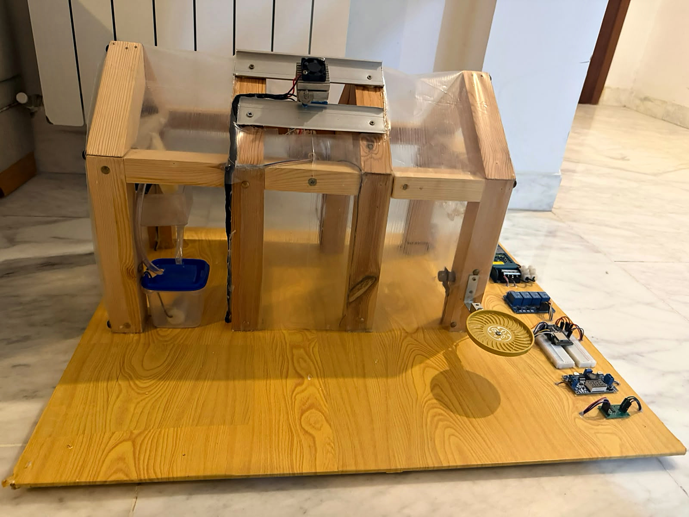
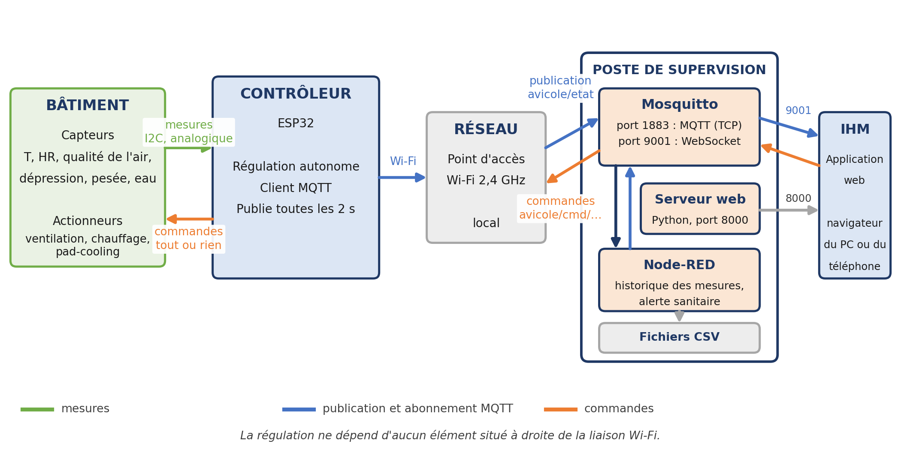

# Contrôleur embarqué low-cost et IoT pour bâtiment d'élevage avicole

**Projet de fin d'études — Ingénieur en mécatronique, Polytech Intl, 2025/2026**
Mohamed Nadim LAMOUCHI, en partenariat avec STE TAADIC (représentant d'Hotraco Agri en Tunisie).

Contrôleur à ESP32 qui régule le climat d'un bâtiment de poulets de chair (chauffage, ventilation,
pad-cooling) et suit l'état physiologique du lot (pesée, consommation d'eau), avec supervision à distance.



## Technologies

- **C++ / Arduino** sur **ESP32** (cœur Espressif)
- **MQTT** avec le broker **Mosquitto** (port 1883, WebSocket 9001)
- **Node-RED** (historique et module d'alerte sanitaire)
- **HTML / CSS / JavaScript** : application web progressive (PWA)
- **Python** : rejeu des scénarios de test de l'alerte

## Architecture



## Contenu du dépôt

```
PFE-Controleur-Avicole-IoT/
├── Arduino_ESP32/
│   ├── code-pfe-arduino/      programme du prototype réalisé (maquette)
│   ├── controleur_mqtt/       programme de la configuration conçue (MQTT) + README
│   └── prototype_thermique/   programme d'essai thermique + GUIDE
├── Application_Web_PWA/       application web de supervision (index.html, app.js, sw.js, manifeste)
├── Node-RED_Supervision/      flux Node-RED, fonction d'alerte sanitaire, scénarios de test
└── images/                    illustrations de ce README
```

| Programme | Rôle |
|---|---|
| `code-pfe-arduino` | Prototype réalisé : DHT11 (GPIO 4), HX711 et cellule de 5 kg (GPIO 32/33), quatre relais actifs à l'état bas (GPIO 18, 19, 21, 22 : ventilation, chauffage, Peltier, pompe), régulation tout-ou-rien à hystérésis, serveur web HTTP intégré, réglages conservés en mémoire non volatile (Preferences) |
| `controleur_mqtt` | Configuration conçue : capteur BME280 ou BMP280 (I2C), régulation par modes autour d'une consigne, publication et commandes par MQTT vers Mosquitto, supervision par l'application web et Node-RED |
| `prototype_thermique` | Essai thermique : chauffage, ventilateur et pad-cooling pilotés selon la température, consigne réglable au moniteur série |

## Compilation et téléversement

1. **Arduino IDE 2** avec le cœur **ESP32** d'Espressif.
2. Bibliothèques : *DHT sensor library* (Adafruit), *HX711* (bogde), *Adafruit BME280* et *Adafruit BMP280*,
   *PubSubClient* ; `WiFi`, `WebServer`, `Preferences` et `Wire` font partie du cœur ESP32.
3. **Avant de téléverser**, remplacer les repères par vos valeurs : `NOM_DU_RESEAU` et `MOT_DE_PASSE`
   (prototype), `WIFI_SSID`, `WIFI_MDP` et `MQTT_HOTE` (configuration conçue).
   Ne jamais publier de véritables identifiants.

Le détail du câblage, des essais et des limites du prototype de démonstration figure dans le rapport du projet.
